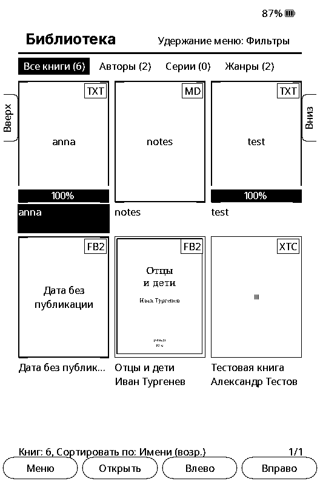
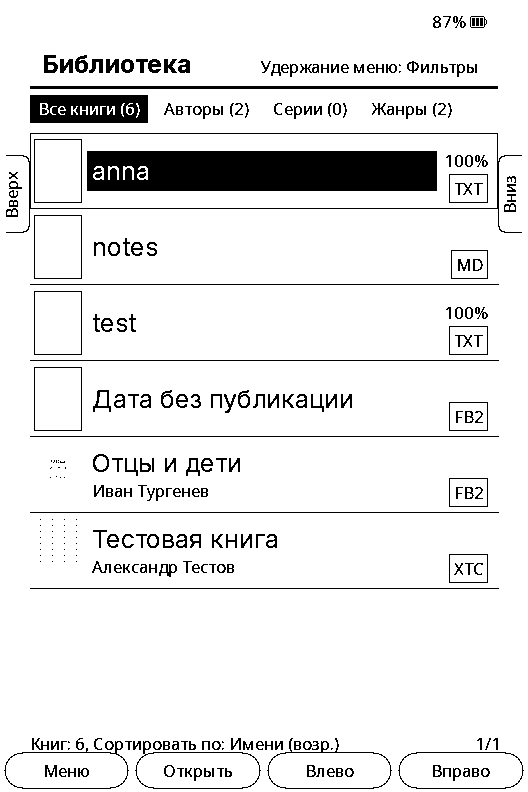
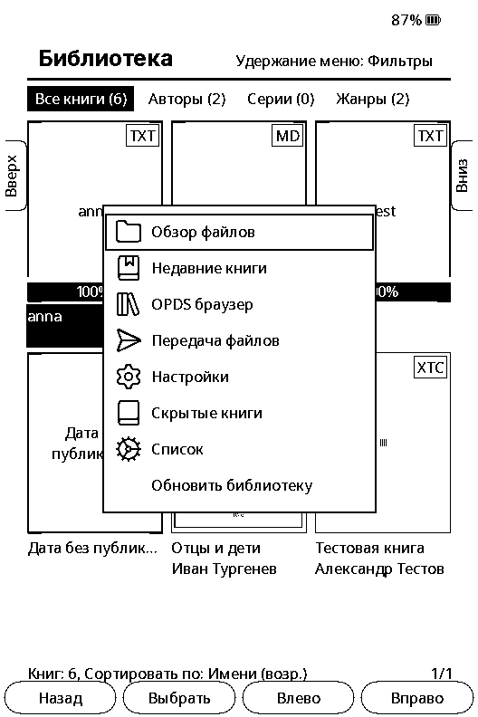
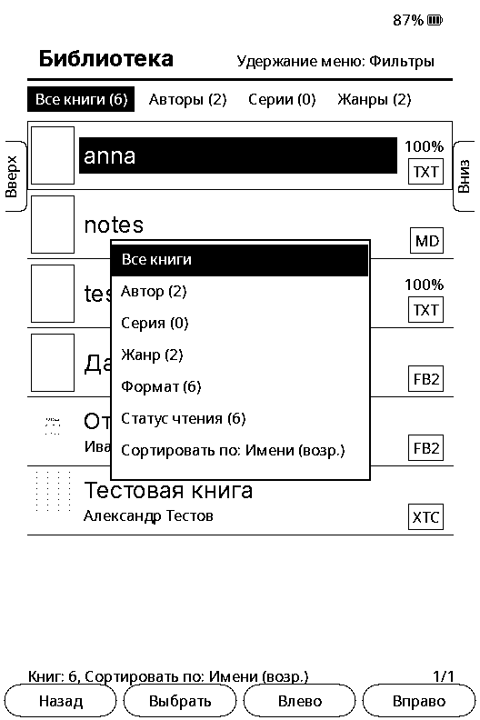
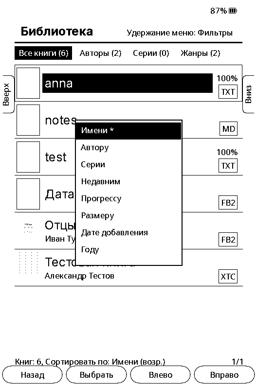
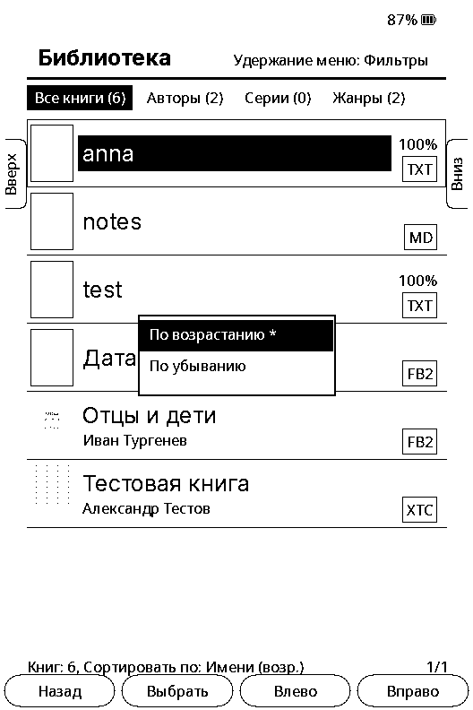
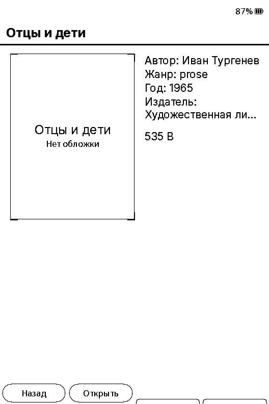
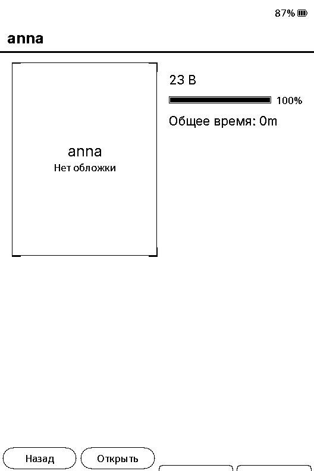

<p align="center">
  
</p>

# Inkwell

Прошивка для ридера **Xteink X3** (ESP32-C3, экран e-ink 792×528, четыре кнопки плюс Power).
Форк [Paperio Reader 2.3.0](https://github.com/Kapfilm/Paperio-Reader): главный экран — библиотека
с обложками, карточкой книги и фильтрами, чтение EPUB, FB2/FB2.zip, TXT, Markdown и XTC.

Текущая версия — **1.0.0**. Образы и заметки к выпускам: [releases](../../releases).

## Что изменено относительно Paperio Reader 2.3.0

**Библиотека (главный экран)**

- Индекс книг на шесть форматов (EPUB, FB2, FB2 в zip, TXT, Markdown, XTC), инкрементальная
  пересборка по размеру и дате файла, индекс переживает перезапуск. Подробности —
  [docs/library.md](docs/library.md).
- Ряд обзора «Все книги / Авторы / Серии / Жанры» с числом книг в каждой категории; обзор
  сужает выборку до одного значения выбранного измерения.
- Фильтры по автору, серии, жанру, формату и статусу чтения (непрочитанные, читаю, прочитано),
  с числами рядом с каждым значением — [docs/library-filters.md](docs/library-filters.md).
- Сортировка по восьми ключам (имя, автор, серия, недавние, прогресс, размер, дата добавления,
  год) и отдельным шагом направления; поле и направление применяются вместе.
- Два вида: плитки с крупными обложками и список — семь строк на экран, с обложкой, названием,
  автором, прогрессом и форматом. Вид запоминается между запусками.
- Пустое состояние объясняет причину и предлагает действие: пересканировать, снять фильтр или
  показать скрытые книги. Скрытые книги живут отдельным экраном и возвращаются в один Confirm.
- Подвал страницы: сколько книг в текущей выборке, по какому ключу и в каком направлении
  отсортировано, счётчик страниц.

**Карточка книги**

- Обложка (встроенная, пользовательская картинка с SD или заглушка с названием и подписью
  «Нет обложки» для текстовых форматов), автор, серия с номером, жанр, год, издатель, число
  страниц (если файл их объявляет), размер файла.
- Описание постранично, если оно длиннее экрана; прогресс чтения, суммарное время чтения и
  переходы по соседним книгам серии.
- Для EPUB и FB2 метаданные берутся из самого файла, для TXT и Markdown — из индекса библиотеки.

**Обложки**

- Единый конвейер: `thumb_<W>x<H>.bmp` в кэше книги, генерация в фоне, отдельные размеры для
  ячейки полки и карточки, политика повторов и очистка кэша удалённых книг.
- Пользовательская обложка EPUB/FB2 из картинки на SD (JPG, PNG, BMP) и возврат к встроенной.

**Проверки и инструменты**

- Полная эмуляция X3 в QEMU: панель, SD-карта, кнопки, I2C-чипы и глубокий сон. Правило проекта:
  образ проверяется в эмуляторе до установки на устройство —
  [tools/qemu/README.md](tools/qemu/README.md).
- Host-симулятор интерфейса `tools/ui_sim` с рендером кадров в PNG —
  [docs/ui-simulator.md](docs/ui-simulator.md).
- Host-тесты (GoogleTest) на индексацию, сортировку и фильтры, парсеры EPUB и FB2, состояние
  библиотеки.

**Брендинг и состав**

- Своё имя, иконка (чёрный круг, белая «i», точка — капля чернил) и экраны загрузки и сна —
  [docs/branding.md](docs/branding.md).
- Убраны Dropbox, погода и игры: интерфейс сведён к чтению и библиотеке.
- Русский и английский интерфейс — [docs/i18n.md](docs/i18n.md).

## Скриншоты

Снято в эмуляторе X3 (`tools/qemu`) с этой прошивки, русский интерфейс. На демонстрационной
карте шесть книг: с обложкой-картинкой с SD, со встроенной обложкой и без неё — последние
показывают плашку с названием.

<p align="center">
  
  
  
</p>
<p align="center">
  
  
  
</p>
<p align="center">
  
  
</p>

## Установка

### С SD-карты

1. Скачайте `inkwell-<версия>.bin` из [последнего релиза](../../releases/latest).
2. Положите файл в **корень** SD-карты (можно переименовать в `firmware.bin`).
3. На устройстве откройте «Настройки → Обновление → Обновление прошивки с SD-карты» и
   подтвердите. Не выключайте питание до сообщения об успехе.

### По воздуху

Проверка обновлений — в системных настройках; канал — только релизы этого репозитория.
Устройство берёт из `firmware-manifest.json` запись для своей платы и сверяет SHA-256 манифеста
с потоком; релиз без манифеста или с чужим хэшем не устанавливается. Версии Inkwell остаются в
линии 1.x: устройство с прошивкой Paperio Reader 2.3.x переходит на Inkwell **только с SD-карты**
(по воздуху сработает защита от понижения версии).

### Какие платы поддерживаются

| Плата | Состояние |
|---|---|
| Xteink X3 | поддерживается, основной образ |
| Xteink X4 | поддерживается тем же образом: профили X3 и X4 собраны вместе, плата определяется в рантайме |
| X4 Classic | не поддерживается — это отдельная сборка другого поколения |
| X4 Pro | не поддерживается: другой MCU (классический ESP32), нужен отдельный таргет |

В релизе образ публикуется под несколькими именами: `inkwell-<версия>.bin` (основное), а также
`firmware.bin`, `firmware-x3.bin` и `firmware-x4.bin` — это те же самые байты для совместимости с
инструментами и привычными именами; хэши у них совпадают.

### Восстановление и защита от «кирпича»

Прошивка проверяет образ до записи (модель чипа, размер, контрольные суммы) и умеет
возвращаться к предыдущей версии; порядок описан в [docs/boot-recovery.md](docs/boot-recovery.md).
Частые проблемы — [docs/troubleshooting.md](docs/troubleshooting.md).

## Управление

| Кнопка | Библиотека | Поп-ап / карточка |
|---|---|---|
| Вверх/Вниз (боковые) | фокус по книгам, ряд обзора сверху | строка списка |
| Влево/Вправо | страница книг | значение |
| Подтвердить | открыть карточку; долгое нажатие — меню книги | выбрать |
| Назад | короткое — главное меню; долгое — фильтры и сортировка | на уровень назад / закрыть |

Кнопки переназначаются в настройках устройства.

## Сборка из исходников

```bash
git submodule update --init --recursive
.venv/bin/pio run -e default          # образ: .pio/build/default/firmware.bin
```

PlatformIO 6.2.0 лежит в `.venv`; сборка идёт для ESP32-C3 (около 5 МБ при слоте 6,25 МБ).

### Тесты

```bash
.venv/bin/python scripts/gen_i18n.py lib/I18n/translations lib/I18n/
cmake -S test -B build/test && cmake --build build/test -j
ctest --test-dir build/test --output-on-failure -j
```

### Эмулятор

```bash
tools/qemu/run-ui.sh .pio/build/default/firmware.bin   # окно с кнопками устройства
```

В эмуляторе настоящие панель, SD-карта и кнопки; радио и глубокий сон моделируются ограниченно.

## Документация

| Тема | Документ |
|---|---|
| Библиотека, фильтры, сортировка | [docs/library.md](docs/library.md), [docs/library-filters.md](docs/library-filters.md) |
| Форматы файлов и кэш | [docs/file-formats.md](docs/file-formats.md) |
| Обновление и восстановление | [docs/boot-recovery.md](docs/boot-recovery.md) |
| Эмулятор X3 в QEMU | [tools/qemu/README.md](tools/qemu/README.md) |
| Host-симулятор интерфейса | [docs/ui-simulator.md](docs/ui-simulator.md) |
| Сеть и веб-интерфейс | [docs/webserver.md](docs/webserver.md), [docs/webserver-endpoints.md](docs/webserver-endpoints.md) |
| Оформление, иконка, версия | [docs/branding.md](docs/branding.md) |
| Заметки к выпускам | [docs/releases](docs/releases) |

## Основа и лицензия

Проект вырос из [Paperio Reader](https://github.com/Kapfilm/Paperio-Reader) (форк CrossPoint
Reader, автор Dave Allie) и сохраняет его лицензию — MIT, см. [LICENSE](LICENSE). История
изменений апстрима остаётся в его собственном репозитории; здесь описан только форк.
